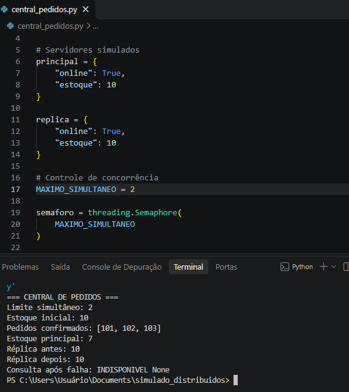
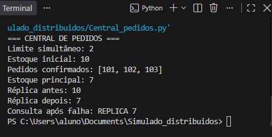
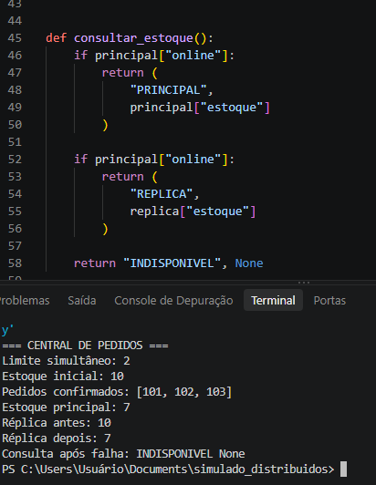

# P2 - SISTEMAS DISTRIBUÍDOS 

**ALUNO:** PEDRO HENRIQUE PRIVADO ALVES

**RA:** 409676312035

**PROFESSORA:** Simone Tatiane do Canto 

**DATA:** 18/11/2026

## 1.Situação-Problema

Uma empresa de comércio eletrônico utiliza um sistema para controlar o processamento de
pedidos.

O sistema possui um servidor principal e uma réplica responsável por manter uma cópia das
informações.

a equipe de TI identificou três problemas:
1. O sistema está permitindo mais processamentos simultâneos do que o limite  estabelecido pela empresa.
2. O estoque da réplica não está sendo atualizado corretamente.
3. Quando o servidor principal fica indisponível, o sistema não consegue utilizar a réplica.

## 2.Primeira Excecução

=== CENTRAL DE PEDIDOS ===
Limite simultâneo: 3
Estoque inicial: 10
Pedidos confirmados: [101, 102, 103]
Estoque principal: 7
Réplica antes: 10
Réplica depois: 10
Consulta após falha: REPLICA 10

### Evidência 1 - Primeira Execução

## 3.Probelma A - Concorrência

Qual Problema Foi Identificado?

o que percebi já de cara e o Limite Simultâneo que e 2 e esta Três.

Qual Alteração foi realizada?

então alterei o Codigo  MAXIMO_SIMULTANEO = 3 para MAXIMO_SIMULTANEO = 2 para ficar no limite maximo estabelecido pela empresa 

### Evidência 2 - Concorrência

## 4.Probelma B - Replicação e Consistência

Qual Problema Foi Indentificado?

o estoque e 10 e não esta desconatndo nada na replica, no caso como foi dito não esta atualizando a replica.

Qual alteração foi realizada?

A alteração realizada foi a segunte alterei a linha que estava erada

def sincronizar():
    replica["estoque"] = replica["estoque"]

Troquei para 

def sincronizar():
    replica["estoque"] = principal["estoque"]

### Evidência 3 - Sincronização

## 5.Probelma C - Tolerância a Falhas

Qual Problema Foi Indentificado?

Qual alteração foi realizada?

### Evidência 4 - Tolerância a falhas

## 6.VALIDAÇÃO DO PROGRAMA

### Evidência 5 - Execução Completa 

## 7.Análise Técnica

## Questão 1 — Qual é a função do semáforo no processamento dos pedidos?

O semáforo serve para controlar quantas threads podem executar uma tarefa ao mesmo tempo. Nesse programa, ele permite que apenas duas tarefas sejam processadas simultaneamente, evitando que muitas threads acessem a mesma região de execução de uma vez.

## Questão 2 — Por que é necessário sincronizar os dados entre o servidor principal e a réplica?

A sincronização é importante para manter os dois servidores com as mesmas informações. Assim, quando o servidor principal atualiza o estoque após o processamento dos pedidos, a réplica também recebe esses dados, evitando diferenças nas informações armazenadas.

## Questão 3 — O que significa tolerância a falhas e como ela aparece neste programa?

A tolerância a falhas permite que um sistema continue funcionando mesmo quando alguma parte apresenta problemas. No programa, isso acontece quando o servidor principal fica indisponível e a réplica assume o atendimento das consultas, permitindo que o serviço continue funcionando.

## Questão 4 — Para que serve o Lock no programa e como o controle de acesso aos recursos ajuda a prevenir problemas de concorrência?

O Lock serve para controlar o acesso aos dados compartilhados, permitindo que apenas uma thread por vez realize determinada operação. No programa, ele protege as alterações no estoque e na lista de pedidos confirmados, evitando que duas threads modifiquem essas informações ao mesmo tempo e causem erros. Também é importante organizar o acesso aos recursos para evitar problemas como os deadlocks.

## Questão 5 — A sincronização do estoque deve acontecer antes ou depois do processamento dos pedidos? Explique a relação de causalidade.

A sincronização deve acontecer depois do processamento dos pedidos, pois primeiro o servidor principal precisa atualizar o estoque com as novas informações. Depois disso, os dados atualizados são enviados para a réplica. Dessa forma, os dois servidores permanecem com informações corretas e seguem a ordem em que as operações precisam acontecer.

## 8.Conclusão

## 9.Entrega 

**ALUNO:** PEDRO HENRIQUE PRIVADO ALVES

**Repositorio:**[https://github.com/pedrohprivado-25/Prova2sistemasDistribuidos]

**DATA:** 18/11/2026
