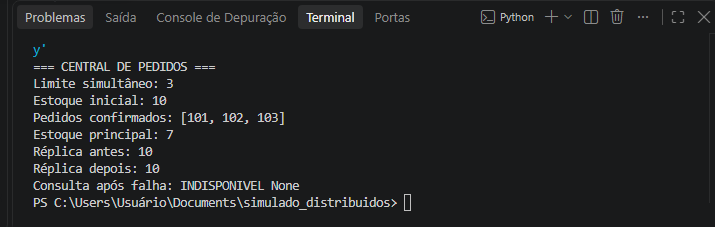

# P2 - SISTEMAS DISTRIBUÍDOS 

**ALUNO:** PEDRO HENRIQUE PRIVADO ALVES
**RA:** 
**PROFESSORA:** Simone Tatiane do Canto 
**DATA:** 18/11/2026

## 1.Situação-Problema

Uma empresa de comércio eletrônico utiliza um sistema para controlar o processamento de
pedidos.

O sistema possui um servidor principal e uma réplica responsável por manter uma cópia das
informações.

a equipe de TI identificou três problemas:
1. O sistema está permitindo mais processamentos simultâneos do que o limite  estabelecido pela empresa.
2. O estoque da réplica não está sendo atualizado corretamente.
3. Quando o servidor principal fica indisponível, o sistema não consegue utilizar a réplica.

## 2.Primeira Excecução

=== CENTRAL DE PEDIDOS ===
Limite simultâneo: 3
Estoque inicial: 10
Pedidos confirmados: [101, 102, 103]
Estoque principal: 7
Réplica antes: 10
Réplica depois: 10
Consulta após falha: REPLICA 10

### Evidência 1 - Primeira Execução

## 3.Probelma A - Concorrência

Qual Problema Foi Identificado?

o que percebi já de cara e o Limite Simultâneo que e 2 e esta Três.

Qual Alteração foi realizada?

então alterei o Codigo  MAXIMO_SIMULTANEO = 3 para MAXIMO_SIMULTANEO = 2 para ficar no limite maximo estabelecido pela empresa 

### Evidência 2 - Concorrência

## 4.Probelma B - Replicação e Consistência

Qual Problema Foi Indentificado?

o estoque e 10 e não esta desconatndo nada na replica, no caso como foi dito não esta atualizando a replica.

Qual alteração foi realizada?

A alteração realizada foi a segunte alterei a linha que estava erada

def sincronizar():
    replica["estoque"] = replica["estoque"]

Troquei para 

def sincronizar():
    replica["estoque"] = principal["estoque"]

### Evidência 3 - Sincronização

